# 跨链买 Token 方案对比：Pump Bridge（自研） vs Relay（Solver 网络）

> 版本：v4 · 2026-10-26（v4：全部图改为统一风格的 SVG，源码在 docs/diagrams/gen.py；v2：补上 Solana 两笔交易的链上数据，卖出费用已完整对账，按我们的需求重写第 6 章；v3：新增第二次实测 §3.7，发现用 SOL 买仍然走 Relay，Pump 实际在做混合路由）
> 目的：弄清 Pump.fun 为什么放弃 Relay、改用自研 Pump Bridge，并为我们自己的「跨链买 token」项目选型。
> 数据来源：Relay 官方文档、Pump.fun 公告和媒体报道、我们自己在 Pump.fun 上测试的 4 笔链上交易（BSC 交易已在链上逐条解码）。
> 标注说明：**[链上确认]** = 从链上日志解码得到；**[推测]** = 根据现象推断，Pump 没有公开；**[待确认]** = 需要补数据。

---

## 0. 一句话结论

- **Relay** 是一个**通用**的「任意链任意币 → 任意链任意币」意图（intent）结算网络。用户把钱存进 Depository 合约，第三方 Solver 先用自己的钱在目标链帮用户完成操作，之后通过 Oracle + Relay Chain（Hub 账本）+ MPC 签名把钱从 Depository 取回。它**安全、去信任、覆盖链多**，代价是**环节多、费用层层叠加、延迟和失败率偏高**。
- **Pump Bridge** 是一个**专用**的「Solana 上的 USDC/SOL → 其他链 meme」**库存式（自营做市）桥**。Pump 在每条链上自己放一个装满 USDC 的金库合约，自己就是唯一的 "Solver"。用户在 Solana 付 USDC 后，Pump 的后端**立即**用 BSC 金库里的 USDC 通过 DEX 聚合器买 meme 发给用户。卖出时反向操作，USDC 留在金库里，再从 Solana 金库付款给用户。**没有 Oracle、没有结算链、没有 MPC 提款**，跨链对账在 Pump 内部完成。
- Pump 换掉 Relay 的核心原因：**速度快约 2 倍（3.88s → 1.95s）、失败率从 11.2% 降到 0.9%、少付 Relay 的各项费用、整条链路和体验由自己掌控**。代价是 Pump 要**自己垫资、自己做资金再平衡、自己承担托管和安全风险**。这些代价只有交易量大、场景窄（只做"Solana → 其他链买 meme"）的平台才划算。
- **实测发现 Pump 现在是"混合路由"**（§3.7）：用 USDC 买走 Pump Bridge，**用 SOL 买仍然走 Relay**，卖出一律走 Pump Bridge（要 SOL 就在出金时用 Jupiter 换）。走 Relay 时 Pump 只收 15 bps App Fee 还要补贴，净收入约等于 0；走自营时能收 0.45% + 约 $0.05。

---

## 1. 背景

| 时间 | 事件 |
|---|---|
| 2026-05 | Pump.fun 上线跨链交易，底层路由使用 Relay |
| 2025-09-28 ~ 10-07* | Pump 应用内随机分流 A/B 测试 Relay vs Pump Bridge（媒体原文日期如此，疑为 2026） |
| 2026-10-21/22 | Pump Bridge 成为默认跨链路由，替换 Relay |
| 2026-10-23 | 竞品 FOMO 宣布同样自研桥和路由，称跨链交易 < 1 秒 |

**Pump 公布的数据**（自测，未经第三方验证）：

| 指标 | Relay | Pump Bridge | 变化 |
|---|---|---|---|
| 典型买入耗时 | 3.88 s（>10% 的单超过 7 s） | 1.95 s | 约快 2 倍 |
| 买入失败率 | 11.2% | 0.9% | 少 92% |
| 中位成交价相对现货价的损耗 | 3.6% | 3.0% | 约少 17% |
| 额外桥费 | Relay 费用 + App Fee | 目前为 0（Pump 用了"目前"一词） | — |
| 平台费 | 0.45% | 0.45% | 不变 |
| 理论最快 | — | ~1.1 s（目标值） | — |

测试样本覆盖 Robinhood Chain（约 53%）、BSC（约 39%）、Base、Arc、Ink，共 383,326 笔。

**当前限制**（你实测得出）：
1. 只支持用 **Solana 上的 USDC / SOL** 买其他链的 meme（单向入口）。
2. 只支持**第三方登录的内嵌钱包**（邮箱/社交登录，类似 Privy/Turnkey），**不支持插件钱包**（Phantom、MetaMask 等）。原因见 §3.4。

---

## 2. Relay 方案详解

### 2.1 Relay 的组成

| 组件 | 位置 | 职责 |
|---|---|---|
| Relay API | 链下 | 报价（quote）、给出执行步骤、追踪状态 |
| **Depository 合约** | 每条支持的链（80+） | 托管用户存款；只有验证过 MPC 签名和 nonce 才会放款给 Solver |
| **Solver** | 链下，用自有资金 | 监听存款 → 在目标链用自己的钱完成用户操作（转账 / swap / 任意调用）→ 之后去结算、提款 |
| **Oracle** | 链下签名服务 | 读源链确认"用户确实存了钱"，读目标链确认"Solver 确实按意图填单了"，然后签发 EIP-712 证明（attestation） |
| **Relay Chain** | 专用结算链（Chain ID 537713，Sovereign rollup，Celestia DA） | 运行 Hub 和 Oracle 合约；每单结算成本约 $0.005 |
| **Hub** | Relay Chain 上的 ERC6909 账本 | 记录用户存款对应的代币余额和 Solver 余额（MINT / TRANSFER / BURN） |
| **Allocator** | Aurora（NEAR 生态） | 用 NEAR MPC 网络生成提款证明（EVM 用 EIP-712，Solana 用 Ed25519） |
| Security Council | — | 安全模型中的最终兜底方 |

### 2.2 系统架构图（Relay）

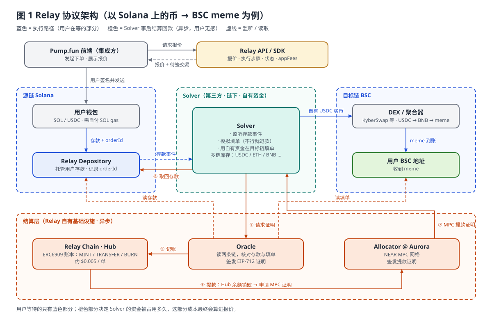

### 2.3 一笔跨链买单的完整时序（Relay）

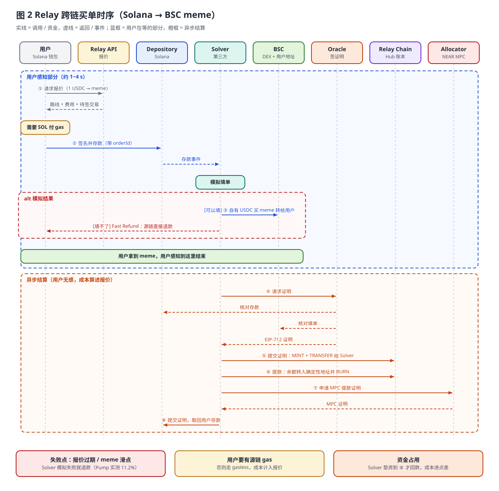

**失败路径（Fast Refund）**：Solver 模拟填单失败（流动性不足、合约报错、**meme 价格波动超出滑点**、报价过期），就在源链直接把钱退给用户，再走一遍证明结算。用户看到的就是"交易失败，已退款"。Pump 公布的 11.2% 失败率主要就出在这里。

### 2.4 资金流转图 + 费用（Relay，买入）

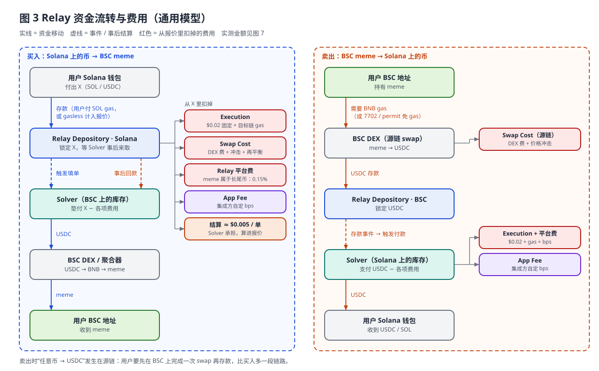

**Relay 买入费用汇总**：

| 费用 | 谁收 | 大概多少 | 说明 |
|---|---|---|---|
| 源链 gas | 网络 | Solana 很低 | 用户要有 SOL，或者 gasless（由 Relay/集成方代付后计入报价） |
| Execution Cost | Solver / Relay | $0.02 + 目标链 gas | 小额订单影响很大：1 USDC 的单光这一项就 2%+ |
| Swap Cost | LP / Solver | DEX 费 + 价格冲击 + 再平衡 | meme 池子浅，价格冲击大；Solver 再平衡成本也算在这里 |
| Platform Fee | Relay | meme 0.15% | 按交易对类型收 bps |
| App Fee | 集成方 | 自定 | Pump 当时设置的具体数值没有公开 |
| 结算成本 | Relay Chain | ~$0.005/单 | 不随 gas 价格波动，Solver 承担 |
| 资金占用成本 | Solver | 隐性 | Solver 垫资到提款完成之前资金被占用，会反映在报价点差里 |

### 2.5 资金流转图（Relay，卖出 meme 回到 Solana USDC）

> 卖出的资金流见上方**图 3 右侧泳道**。

> 注意：卖出时"任意币 → USDC"这一步发生在**源链**（这里是 BSC），也就是用户要先在 BSC 上完成一次 swap 再存款，链路比买入更长。

---

## 3. Pump Bridge 方案详解（根据链上交易反推）

### 3.1 实测交易解码

**涉及的地址**（Solana）：

| 地址 | 身份 | 依据 |
|---|---|---|
| `CS4UmCKHvLztGc9Pb8DN5JHXw8sNRpo5Htyxfqh4AFgi` | **你的 Solana 地址**（内嵌钱包） | — |
| `Dsug6J…aAEnzK` | **Pump Bridge 的 Solana 程序**（自研合约） | 入金、出金都通过它 [链上确认] |
| `5Zs2Gi…26B4aC` | **Pump Bridge 的 Solana USDC 金库** | 买入时收你的 1 USDC，卖出时给你付 USDC [链上确认] |
| `FHpcNSe6tb2n15bAdq4BkeYWGyZKFD7yLYrH92ng7wCT` | Pump 的 **fee payer**（代付 SOL 网络费） | 买入交易的第一签名人，你是第二签名人 [链上确认] |
| `6aQtW5iAbWYnymVJHPSUPM44dC1XDE7B4TjHrFGoTZm6` | Pump 的 **出金执行者**（金库出款权限） | 卖出交易**只有它一个签名人**，不需要你签名 [链上确认] |
| `KfHbT5…HrzMFQ` | Pump **平台费收款账户** | 卖出时收到 0.45% [链上确认] |

**涉及的地址**（BSC）：

| 地址 | 身份 | 依据 |
|---|---|---|
| `0x6733…a8ae` | Pump 的**执行者 / 代付 gas 的热钱包** | 买入、卖出两笔交易都由它发起并支付 BNB gas [链上确认] |
| `0x836b…d13b` | Pump Bridge **金库 / 路由合约**（存放 USDC 库存） | 买入时 USDC 从这里流出，卖出时 USDC 回到这里 [链上确认] |
| `0x3b7d…cd96` | **你的 BSC 地址**（内嵌钱包的 EVM 地址） | meme 发到这里；卖出交易是**发给这个地址的 EIP-7702（type 4）交易** [链上确认] |
| `0x0000…1ff3684f28c67538d4d072c22734` | 0x Protocol 的 AllowanceHolder | 金库给它授权 [链上确认] |
| `0x5be1…bbdb` | 0x Settler（DEX 聚合器执行合约） | 实际执行多跳 swap [链上确认] |
| `0x4141…6d48` / `0xf268…12c4` | USDC/WBNB V3 池 | Swap 事件 [链上确认] |
| `0x82b4…c8a4` | meme/WBNB（PancakeSwap V3 型）池 | Swap 事件 [链上确认] |
| `0xe552…30a3e2` | 你买的 meme 代币 | — |

**买入（2026-10-23 05:05:06 UTC）**

| # | 链 | 交易 | 发生了什么 |
|---|---|---|---|
| 1 | Solana | `4nCs…4y79`（05:05:06） | 调用 Pump 程序 `Dsug6J`：你的地址 → 金库 `5Zs2Gi` 转 **1 USDC**。签名人：`FHpc…`（付 0.000016 SOL ≈ $0.0016 网络费）+ 你（授权转账）。**只有这一笔转账**，没有单独拆出手续费 [链上确认] |
| 2 | BSC | `0xe248…dae3` | `0x6733` 调用金库 `0x836b` → 金库拿 **0.9455 USDC** 通过 0x 聚合器换成 0.001279 WBNB → 再换成 **66.806 meme** → 回到金库 → 转给你的 `0x3b7d`。金库抛出事件，带 16 字节订单号 `0x13cd60cd…31fe`（像后端生成的 UUID）[链上确认]。gas 315,240 × 0.06 gwei ≈ 0.0000189 BNB ≈ **$0.014**（由 Pump 支付） |

**卖出（2026-10-23 05:11:23 UTC）**

| # | 链 | 交易 | 发生了什么 |
|---|---|---|---|
| 3 | BSC | `0x4852…583f3c` | `0x6733` 向**你的地址 `0x3b7d`** 发送 **EIP-7702** 交易（你的 EOA 已委托给 Pump 的智能账户代码）。批量执行：① `approve(金库, 66.806 meme)` ② 调用金库卖出（带订单号 `0x93831d81…afaf`、最少到手 0.8333 USDC、截止时间）。金库把 meme 从你地址拉走 → 0x 聚合器 → WBNB → **0.92197 USDC 留在金库**。gas 415,474 ≈ 0.0000249 BNB ≈ **$0.018**（由 Pump 支付）[链上确认] |
| 4 | Solana | `5ZG7…7jub`（05:11:24） | 出金执行者 `6aQt…` 单独签名，调用 Pump 程序，金库 `5Zs2Gi` 转出两笔：**0.899372 USDC → 你**；**0.004148 USDC → 平台费账户 `KfHbT5`**。网络费 0.000022 SOL 由 Pump 付 [链上确认] |

> 链上 swap 价格反推的 BNB 价格约为 **$740**，上面的 gas 美元价就是按这个价格算的。

**卖出对账（精确到 6 位小数）** [链上确认]：

```
BSC 卖出得到              0.921972 USDC
− 平台费 0.45%           0.004148  （= 0.921972 × 0.45%，转到 KfHbT5）
− BSC gas 实报实销        0.018452  （= 415,474 gas × 0.06 gwei × $740.2，留在金库）
= 用户 Solana 到账        0.899372 USDC  ✅ 分毫不差
```

**结论：卖出按"0.45% 平台费 + 实际 gas 实报实销"收费**，gas 按链上实际消耗精确扣除，Pump 在 gas 上不赚差价。

**延迟**：买入时 Solana 和 BSC 两笔交易的时间戳在**同一秒**（05:05:06）；卖出时 BSC 05:11:23 → Solana 05:11:24，**1 秒**。和官方公布的 1.95 s 一致。

**结论**：BSC 上**完全没有**任何"存款 → Oracle → 结算"类的步骤。跨链只体现在**两条链上各一笔交易**，中间靠 Pump 后端的订单号对账。这就是一个**由 Pump 自己做市（库存式）的桥**。

### 3.2 系统架构图（Pump Bridge，推测还原）

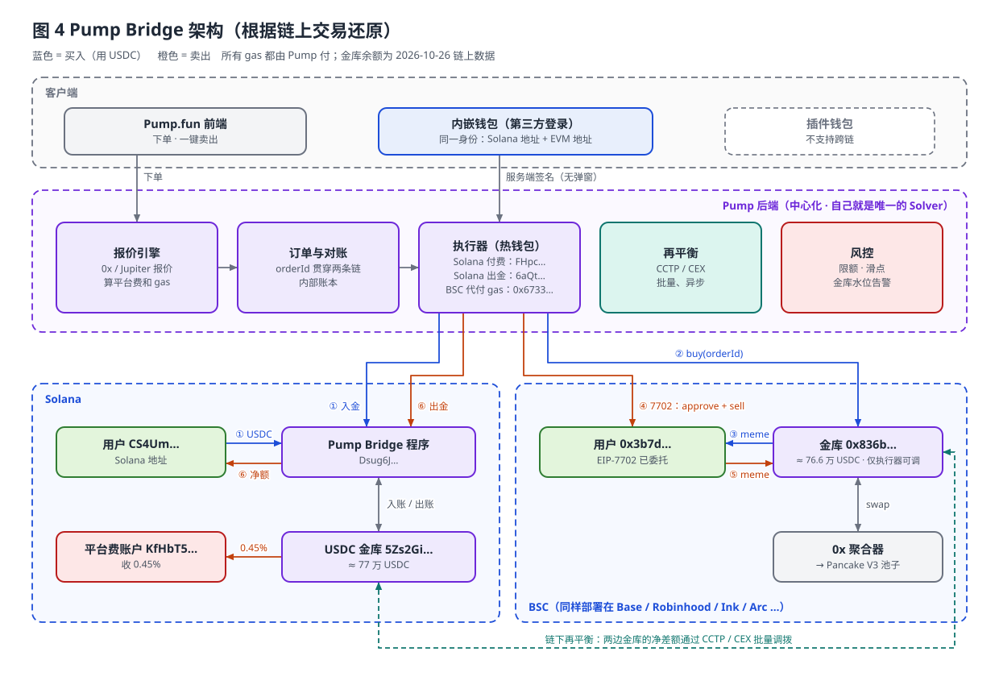

### 3.3 时序图（Pump Bridge 买入 + 卖出）

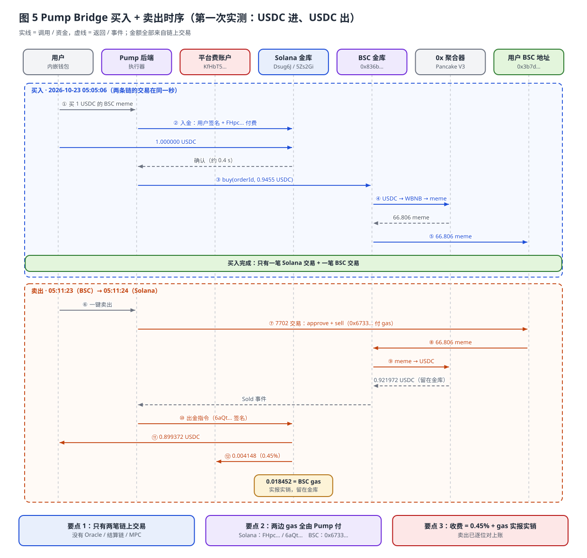

### 3.4 为什么只支持「第三方登录钱包」

[推测，但和链上证据吻合]

1. **用户要在每条 EVM 链上有一个由同一身份控制的地址**：内嵌钱包（Privy/Turnkey 一类）登录后会同时生成 Solana 地址和 EVM 地址。插件钱包（如 Phantom 的 Solana 账户）在 BSC 上没有对应的 EOA，或者不能被应用静默调用。
2. **卖出依赖 EIP-7702**：卖出交易是发给用户 EOA 的 type 4 交易，说明用户地址已经委托给 Pump 的智能账户代码，Pump 的执行器才能代用户发起"approve + sell"并代付 BNB gas。插件钱包基本不支持应用发起 7702 授权，也做不到无弹窗签名。
3. **两边都免 gas**：Solana 买入交易有两个签名人，`FHpc…` 是 fee payer，你只负责授权转账 [链上确认]；BSC 侧由 `0x6733` 代付。这需要钱包配合"应用构造交易 + 后台静默签名"，内嵌钱包最容易做到。
4. **秒级体验**：插件钱包每一步都要弹窗确认，"一键买 / 一键卖"的 1.95 秒体验就做不到了。

### 3.5 资金流转图 + 费用（Pump Bridge，买入，按实测数据）

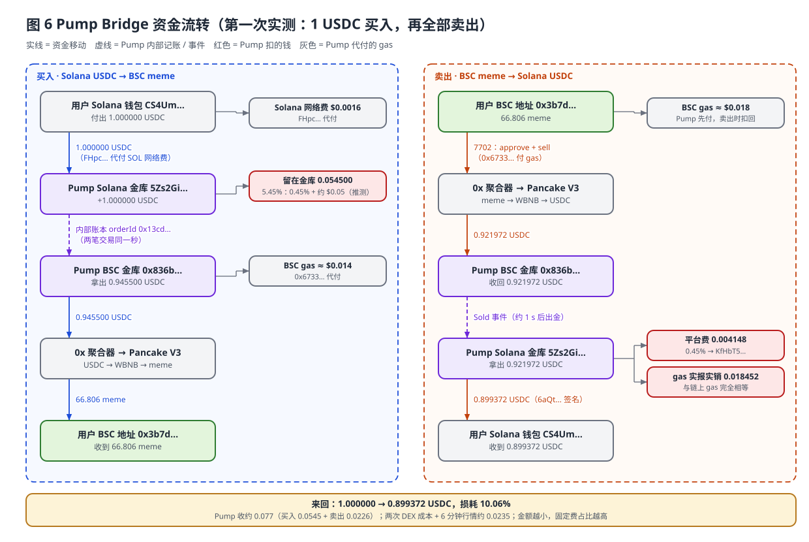

### 3.6 资金流转图 + 费用（Pump Bridge，卖出）

> 卖出的资金流见上方**图 6 右侧泳道**（含平台费和 gas 实报实销的逐位对账）。

**Pump Bridge 本次测试的费用汇总**：

| 环节 | 金额（USDC） | 说明 |
|---|---|---|
| ① 用户付出 | 1.000000 | Solana [链上确认] |
| ② 买入扣费 | −0.054500（5.45%） | 平台费 0.45% ≈ 0.0045 + 约 0.05 固定费 / 最低收费 [推测]。BSC 买入 gas 实际只有 $0.014，Solana 网络费 $0.0016，所以这 0.05 不是 gas 实报实销。**金额越小，固定费占比越高** |
| ③ 实际用于 BSC 买入 | 0.945500 | [链上确认] → 66.806 meme |
| ④ 两次 DEX 成本 + 6 分钟价格变化 | −0.023528 | 0.9455 → 0.921972，包括两次 V3 池手续费、价格冲击、行情波动 |
| ⑤ 卖出 swap 得到 | 0.921972 | 留在 BSC 金库 [链上确认] |
| ⑥ 卖出平台费 0.45% | −0.004148 | 转到 `KfHbT5` [链上确认] |
| ⑦ BSC 卖出 gas 实报实销 | −0.018452 | 与链上 gas 完全相等 [链上确认] |
| ⑧ 用户最终到账 | **0.899372** | Solana [链上确认] |
| **来回总损耗** | **0.100628（10.06%）** | 其中 Pump 收取约 0.077，DEX 和行情约 0.0235。**1 USDC 这种小额会把固定费放大，10 / 100 USDC 下占比会明显变小** |
| 跨链桥费 | 0 | 官方说"目前"不收 |
| Oracle / 结算链 / MPC 费用 | 无 | 没有这些组件 |
| 隐性成本（Pump 承担） | 库存资金占用 + 再平衡费用 + 价格风险 | 不直接向用户收取 |

**Pump 收费规则（归纳）**：
- 卖出：`平台费 0.45% × 卖出所得` + `目标链 gas 实报实销` [链上确认]
- 买入：`平台费 0.45%` + `约 $0.05 固定费` [推测：可能包含买入 gas、未来卖出 gas 的预留，或者最低收费]，两项都在 Solana 入金时直接从金额里扣，留在金库

### 3.7 第二次实测：用 SOL 买 → 走 Relay；卖出 → 走 Pump Bridge 并换回 SOL

> 2026-10-26 01:06 ~ 01:08 UTC，同一个 meme（`0xe552…`，Binance Super CZ），同一组用户地址。

| # | 链 | 交易 | 走的路线 |
|---|---|---|---|
| 1 | Solana | `f5Lb…BJkN`（01:06:21） | **Relay**：用户把 0.009888263 SOL 存进 Relay Depository |
| 2 | BSC | `0xba21…7eb3`（01:06:22） | **Relay Solver** 在 BSC 上填单 |
| 3 | BSC | `0x7256…c833`（01:08:26） | **Pump Bridge**：meme 卖进 Pump 金库 `0x836b` |
| 4 | Solana | `A3Vm…Garc`（01:08:27） | **Pump Bridge**：Pump 金库出 USDC → Jupiter 换成 SOL → 打给用户 |

#### 3.7.1 买入（Relay 路线）解码

**Solana 侧** [链上确认]
- 调用的程序是 `99vQwtBwYtrqqD9YSXbdum3KBdxPAVxYTaQ3cfnJSrN2`，指令 `DepositNative`，也就是 **Relay Depository**。
- 你的地址 → Depository 金库 `7uTT8Xi5…i8pZ` 转 **0.009888263 SOL**（约 $0.9999）。
- **只有你一个签名人，网络费 5000 lamports 由你自己付**。这一次没有 Pump 代付，因为你账户里有 SOL。
- 事件里带着 Relay 的订单 ID `0x6be430ad…80af`，BSC 填单交易的 input 里也有这个 ID，两边靠它对应。

**BSC 侧** [链上确认]
- 发起方 `0xcc4b…7a1a` 是 Relay Solver 的执行钱包，调用 Solver 合约 `0xccc8…15be`。
- Solver 资金地址 `0xf70d…dbef` 拿出 **0.924174 USDC** → Relay 路由合约 `0xb92f…ff4f` → **KyberSwap**（`0x6131…37b5`），路径是 USDC → USDT → BNB → meme，得到 **1505.79 meme** 发给你的 `0x3b7d`。
- KyberSwap 的事件里写着 `"Source":"relay-pumpfun"`，说明这是 Relay 为 Pump 集成方执行的单。
- BSC gas 663k × 0.0715 gwei ≈ 0.0000474 BNB ≈ **$0.035**，由 Solver 先垫付。
- 从 Solana 存款到 BSC 到账约 **1 秒**。Relay API 的 `timeEstimate = 1`，但 `updatedAt` 比 `createdAt` 晚 31 秒，说明后台结算还多花了几十秒（用户感知不到）。

**Relay 官方费用明细**（来自 Relay 公开 API `GET /requests/v2?hash=f5Lb…`，`actual` 字段）：

| 费用项 | 金额（USD） | 说明 |
|---|---|---|
| 用户付出 | 0.999890 | 0.009888263 SOL |
| Execution（gas） | 0.058160 | 按 BSC 预估 gas 收；**实际链上 gas 只有约 $0.035**，多收了约 $0.023 作为 gas 缓冲 / 利润 |
| Execution（fixed） | 0.020044 | 文档里的 $0.02 固定费 |
| Swap / price | 0.004161 | Solver 把 SOL 换成 USDC 的价差和再平衡成本 |
| Relay 平台费（gateway） | 0.001501 | **15 bps**，和文档里"长尾币 0.15%"一致 |
| **Pump App Fee** | 0.001501 | **只有 15 bps**，收款地址 `0xDAB3…aDf7`，用 SOL 计价 |
| Pump 代付（sponsor） | −0.001499 | Pump 用 Base 上的 USDC 补贴了 $0.0015（已达上限 `capHit`） |
| 正滑点返还 | +0.005813 | 实际成交比报价好 |
| **用户实际到手** | **0.924556**（1505.79 meme） | 损耗 **$0.0753（7.53%）** |

其他字段：`slippageTolerance = 1000`（10% 滑点容忍）、`subsidizedRequest = true`、目标链路由 `kyberswap`。

> **关键发现：走 Relay 时，Pump 自己几乎赚不到钱。**用户付出的 $0.075 里，Relay 和 Solver 拿走约 $0.072（gas 多收的部分、固定费、平台费、换币价差），Pump 只收到 $0.0015 的 App Fee，还补贴了 $0.0015，**净收入约等于 0**。而走自家 Pump Bridge 时，Pump 收 0.45% + 约 $0.05，gas 按实际花费扣回。**这是 Pump 换掉 Relay 最直接的经济动机。**

#### 3.7.2 卖出（Pump Bridge 路线，回到 SOL）解码

**BSC 侧** [链上确认]
- 和第一次一样：`0x6733` 调用你的地址 `0x3b7d`，把 1505.79 meme 卖进金库 `0x836b`，经 0x 聚合器换成 **0.923175 USDC** 留在金库。
- 这次是**普通的 type 2 交易**，不是 type 4。因为第一次卖出时 7702 委托已经写进你的地址，之后会一直有效。查询你地址的代码是 `0xef0100…9b8f00`，表示已委托给 `0x0000…9b1d0af20d8c6d0a44e162d11f9b8f00`（疑似 Uniswap Calibur 的 7702 智能账户实现，[待确认]）。

**Solana 侧**（一笔交易，只有 Pump 的 `6aQt…` 签名）[链上确认]
1. Pump 程序 `Dsug6J` 的 `AdminDebit` 指令执行两次：
   - 金库 → 平台费账户 `KfHbT5`：**0.004154 USDC**（= 0.923175 × 0.45%）
   - 金库 → `6aQt` 的临时 USDC 账户：**0.899776 USDC**
2. **Jupiter**（`JUP6…`，经 Tessera V 池子）把 0.899776 USDC 换成 **0.008905774 SOL**。交易里带了 `jitodontfront` 账户，用来防夹子（MEV）。
3. 解包 wSOL 后转给你 **0.008906913 SOL**。比 swap 实际得到的多出 1139 lamports（约 $0.0001），应该是 Pump 按报价金额付款、自己补上了差额。
4. Solana 网络费 19000 lamports 由 Pump 付。

**卖出对账** [链上确认]：
```
BSC 卖出得到                 0.923175 USDC
− 平台费 0.45%              0.004154  → KfHbT5
− BSC gas 实报实销           0.019245  （链上 gas 434,221 × 0.06 gwei × $738.5 = $0.019239，差 $0.000006，是 BNB 价格取值误差）
= 拿去换 SOL 的 USDC         0.899776
→ Jupiter 换成               0.008905774 SOL（+ Pump 补 1139 lamports）
= 用户到账                   0.008906913 SOL ≈ $0.8999
```
**和第一次卖出的收费规则完全一样：0.45% + gas 实报实销**。如果要收 SOL，Pump 会在同一笔 Solana 交易里用 Jupiter 把 USDC 换成 SOL，换币成本由用户承担。

#### 3.7.3 第二次测试的资金流转图

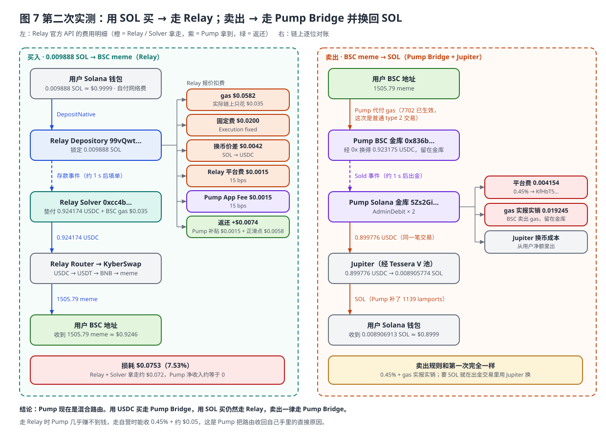

#### 3.7.4 两次测试放在一起对比

| | 第一次（USDC 进 → USDC 出） | 第二次（SOL 进 → SOL 出） |
|---|---|---|
| 买入路线 | **Pump Bridge** | **Relay** |
| 买入时 Solana 网络费 | Pump 代付 | **用户自付** |
| 买入速度 | 同一秒 | 约 1 秒 |
| 买入扣费 | $0.0545（5.45%） | $0.0753（7.53%） |
| Pump 在买入上的收入 | 0.45% + 约 $0.05 | **15 bps − 补贴 ≈ 0** |
| 卖出路线 | Pump Bridge | Pump Bridge（+ Jupiter 换成 SOL） |
| 卖出扣费规则 | 0.45% + gas 实报实销 | 0.45% + gas 实报实销（+ 换 SOL 的 swap 成本） |
| 来回总损耗 | 10.06% | 约 10.0%（$0.9999 → $0.8999） |

#### 3.7.5 结论：Pump 现在是"混合路由"

1. **Pump 并没有完全去掉 Relay。** 现在看到的路由规则 [推测，依据是两次测试]：
   - **用 USDC 买** → Pump Bridge（Solana 金库只存 USDC，直接入账）
   - **用 SOL 买** → Relay（Pump 的 Solana 程序还不支持"收 SOL → 换成 USDC → 入金库"这一步，所以回退到 Relay，由 Solver 处理 SOL）
   - **卖出（不管收 USDC 还是 SOL）** → 一律 Pump Bridge。要 SOL 的话，Pump 在出金那笔交易里直接用 Jupiter 换。
2. **卖出比买入更容易自营**：卖出时 Pump 手里本来就是 USDC，换成 SOL 只要在出金交易里加一步 Jupiter；买入时要先把用户的 SOL 换成 USDC，再入金库，对原子性和滑点控制的要求更高。Pump 先做了容易的部分，**SOL 买入很可能是下一步要迁移的部分**。
3. **库存规模**（2026-10-26 链上余额）：Pump Solana USDC 金库约 **770,042 USDC**，BSC 金库约 **765,502 USDC**，BSC 执行器热钱包约 1.5 BNB。**每条主力链大约放了 $77 万的库存**，这可以作为我们估算资本需求的参考。
4. 这和我们在 §6.3 推荐的"**自营为主 + Relay 兜底**"架构一致，Pump 自己也在这么做。


---

## 4. 两套方案逐项对比

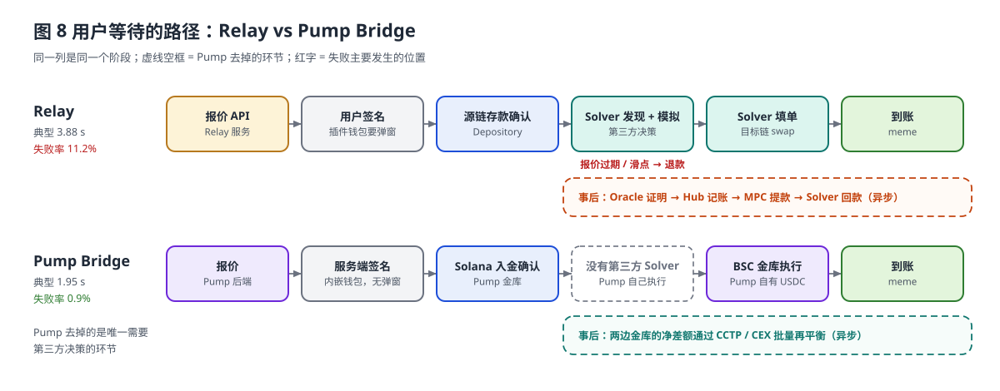

> Pump 把用户路径上唯一需要第三方决策的环节（Solver 模拟）去掉了，这是失败率从 11.2% 降到 0.9% 的主要原因。

| 维度 | Relay | Pump Bridge |
|---|---|---|
| 定位 | 通用：任意链任意币 ↔ 任意链任意币（80+ 链） | 专用：Solana USDC/SOL ↔ 少数 EVM 链 meme |
| 谁垫资 | 第三方 Solver | Pump 自己（每条链放 USDC 库存） |
| 信任模型 | 用户钱先进 Depository；Oracle + MPC + Security Council 保证 Solver 不能乱拿钱 | **完全信任 Pump**：用户先把钱付给 Pump，Pump 承诺在另一条链交付 |
| 用户路径上的交易数 | 源链存款（+ 可能的源链 swap）+ 目标链 fill | 源链 1 笔 + 目标链 1 笔 |
| 用户路径上的链下环节 | 报价 API → Solver 监听 → Solver 模拟 / 决策 | Pump 自家后端（同一机房，延迟最低） |
| 事后结算 | Oracle 证明 → Relay Chain Hub → Allocator MPC → Depository 提款 | 无链上结算；内部账本 + 定期再平衡 |
| 速度（Pump 数据） | 3.88 s | 1.95 s |
| 失败率（Pump 数据） | 11.2% | 0.9% |
| 失败原因 | 报价过期、Solver 不接单 / 模拟失败、meme 滑点、多方协调 | 金库余额不足、DEX 滑点 |
| Gas | 用户需要源链 gas，或 gasless（成本计入报价） | Pump 两条链全代付 |
| 费用层级 | Execution + Swap Cost + Platform（meme 0.15%）+ App Fee + 隐性资金成本 | Pump 平台费 0.45% + gas 实报实销（卖出已确认）+ 买入约 $0.05 固定费（推测）+ DEX 成本 |
| 钱包要求 | 任意钱包（插件钱包可用） | 只能用内嵌钱包（要 7702 + 无弹窗 + 代付 gas） |
| 接新链成本 | 低：Relay 支持就能用 | 高：部署金库、准备库存、接聚合器、做再平衡、做监控 |
| 资本需求 | 无 | 高：每条链都要放足够的 USDC，覆盖峰值净流量 |
| 风险承担方 | Solver 承担垫资和价格风险；用户受 Depository 保护 | Pump 承担托管、热钱包、库存失衡和价格风险；用户承担 Pump 的对手方风险 |
| 可控性 | 依赖 Relay 的报价、Solver 的接单策略和升级节奏 | 全部自己掌控：报价、滑点、重试、体验、收费 |
| 合规 | Relay 是基础设施，集成方不托管资金 | Pump 实际上在托管 / 兑付用户资金（类似支付机构），合规负担更重 |

---

## 5. Pump 为什么放弃 Relay

1. **速度是 meme 交易的生命线**
   meme 价格按秒波动。Relay 的链路是"报价 → 用户签名 → 源链存款确认 → Solver 发现 → Solver 模拟 → Solver 目标链执行"，中间要和第三方协调。Pump 把这些都放进自家后端，路径上只剩两笔链上交易，耗时直接减半。

2. **失败率太高，而且主要因为"通用"**
   Relay 的 Solver 要为每一单报价、承担风险。meme 是长尾币，池子浅、波动大，Solver 一模拟发现滑点超标或报价过期就会退款，所以失败率超过 11%。Pump 自己执行时可以用更合适的滑点、实时重新报价、失败马上重试，失败率降到 0.9%。

3. **费用层层叠加**
   Relay 给 meme 收 0.15% 平台费，加上 $0.02 固定执行费、Solver 再平衡成本、资金占用点差，再加 Pump 自己的 App Fee，用户要多付好几层。自营之后中间商的钱都省了，Pump 可以宣传"不收桥费"，平台费仍然保持 0.45%。

   **实测证据（§3.7.1）**：一笔 $1 的 SOL 买单走 Relay，用户付出 $0.075 的费用，其中 Relay 和 Solver 拿走约 $0.072（gas 按 $0.058 收，实际只花了 $0.035），**Pump 只收到 15 bps 的 App Fee，还补贴了同样多，净收入约等于 0**。同样规模的单走 Pump Bridge，Pump 能收 0.45% + 约 $0.05。**收入从中间商转回自己手里，是最直接的经济动机。**

4. **Pump 的场景很窄，用不上"通用"能力**
   Relay 最强的是"任意币 → 任意币、80+ 链"。Pump 只需要**一个入口（Solana USDC/SOL）× 少数几条热门链 × 一种操作（买 / 卖 meme）**。为这个场景付通用协议的复杂度和费用并不划算。

5. **交易量大到值得自己做市**
   Pump 的跨链交易量足够大，单边库存可以靠买卖双向对冲（有人买 BSC meme，就有人卖），净流量小，再平衡成本低。自营的库存成本被摊薄，规模经济成立。

6. **掌控体验和经济模型**
   代付 gas、7702 一键卖、内嵌钱包、订单级对账都由自己掌控；以后想怎么收费（比如重新收桥费、做价差）也由自己定，不受 Relay 定价和升级节奏影响。竞品 FOMO 也在一天后跟进自研，说明这是头部交易应用的共同方向。

7. **代价（Pump 能接受，但不是所有团队都能接受）**
   - 要准备多链 USDC 库存，资金被占用；
   - 热钱包和金库是安全重点，一旦被盗，损失由平台承担；
   - 再平衡、对账、监控、风控要专门的团队运维；
   - 用户放弃了 Relay 那种"存款可以退回"的去信任保护，完全信任 Pump；
   - 钱包形态受限（只支持内嵌钱包）。

---

## 6. 我们项目的选型建议

### 6.1 优劣总结

**Relay 方案（集成第三方 Solver 网络）**

| 优势 | 劣势 |
|---|---|
| 接入快：调 API / SDK，几周就能上线 | 慢：3~4 s，长尾订单超过 7 s |
| 不需要资本，也不托管用户资金，合规负担轻 | 失败率高（meme 场景约 10%） |
| 链和币覆盖广，任意币都能互换 | 费用叠加：执行费 + 平台费 + swap 成本 + 资金点差 |
| 去信任：Depository + Oracle + MPC，有退款保障 | 体验和定价受 Relay 制约，出了问题只能等对方修 |
| 可以通过 App Fee 直接赚钱 | 对小额订单不友好（$0.02 固定费等） |
| 支持插件钱包 | 差异化弱：竞品用同一套基础设施 |

**Pump Bridge 方案（自研库存式桥）**

| 优势 | 劣势 |
|---|---|
| 快：理论上只需两笔链上交易，约 1~2 s | 需要大量资本放在多条链上 |
| 失败率低，体验可以做到"一键" | 托管 + 热钱包安全风险，平台兜底 |
| 没有中间商费用，定价自由 | 要自建再平衡、对账、风控、监控 |
| 可以做全链路 gas 代付和 7702 体验 | 只适合窄场景；接新链成本高 |
| 体验差异化强 | 用户必须信任平台；合规上接近支付 / 兑换机构 |
| 交易量越大越划算 | 钱包形态受限（要内嵌钱包） |

### 6.2 我们的需求和 Pump 的区别

| 需求 | Pump.fun | 我们 |
|---|---|---|
| 充值入口 | 只能从 Solana（USDC / SOL）充值 | **多条链都能充值**（Solana + 各 EVM 链） |
| 插件钱包 | 不支持 | **支持，但只能买本链代币**（直接走本链 DEX 聚合器，用户自己签名、自己付 gas） |
| 跨链买币 | 只支持第三方登录钱包 | **一样：只支持第三方登录钱包**，私钥由我们服务器托管，**不能导出** |
| 跨链方向 | Solana → 其他链（单入口） | **任意已支持链 ↔ 任意已支持链**（多入口、多出口） |

这几个需求带来的直接影响：
1. **私钥由服务器托管**，跨链交易不用等用户签名，服务器可以直接构造、签名、提交。速度上限和 Pump 一样，体验甚至可以更简单。代价是我们成了**托管方**，密钥安全和合规是第一要务。
2. **多入口**意味着金库不再是"一个入口 + N 个出口"，而是 **N 条链两两互通**。每条链的金库既可能收钱也可能付钱，再平衡要按"净流量"来做。
3. **插件钱包只做本链交易**，所以完全不用碰跨链，直接接 DEX 聚合器就行，和跨链系统解耦。

### 6.3 推荐方案：自营库存桥为主 + Relay 兜底的混合架构

核心思路是把两类事情分开处理：
- **对延迟敏感的事（跨链买卖 meme）** → 走**自营库存桥**，目标是 1~2 秒、失败率 < 1%。
- **对延迟不敏感的事（从长尾链充值、跨链提现、金库再平衡）** → 走 **Relay / CCTP / CEX**，慢几秒没关系，不需要我们在长尾链放库存。

#### 6.3.1 系统架构图（我们的项目）

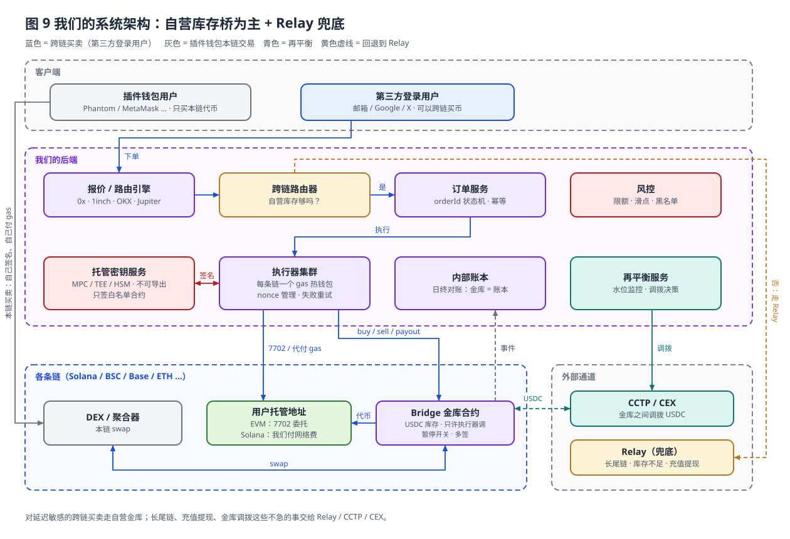

#### 6.3.2 跨链买入时序（例：用 Base 上的 USDC 买 BSC meme）

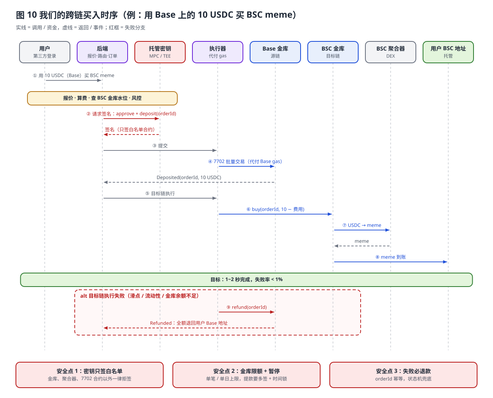

#### 6.3.3 资金流转图（跨链买入，含费用）

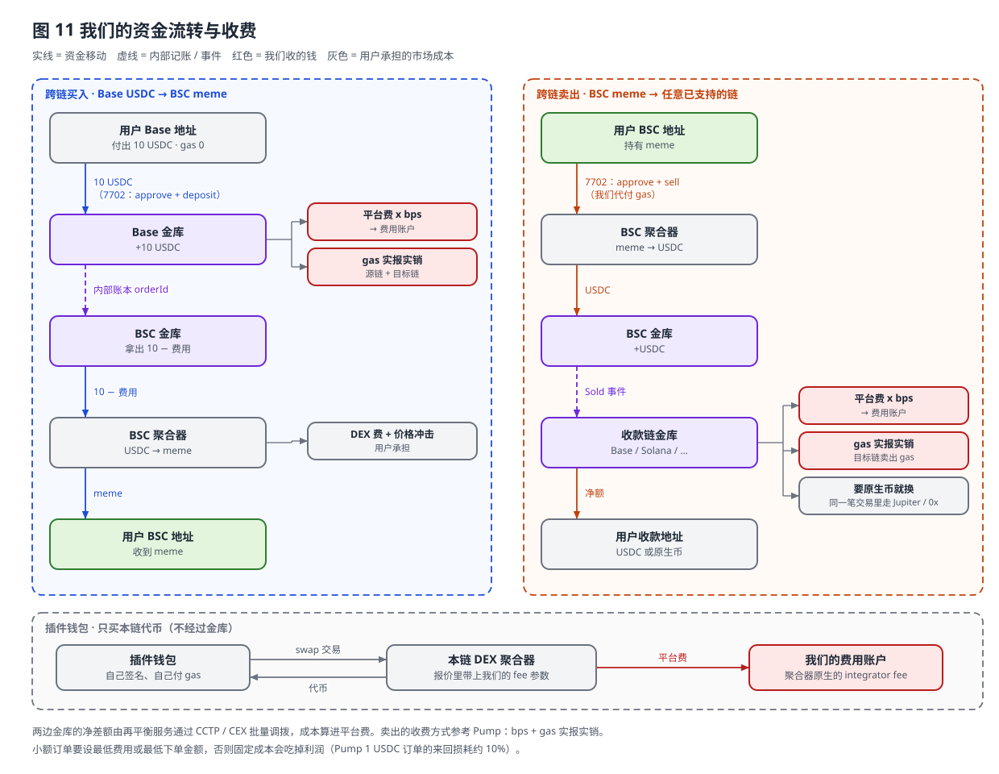

#### 6.3.4 资金流转图（跨链卖出，回到任意链）

> 见上方**图 11 右侧泳道**。

#### 6.3.5 资金流转图（插件钱包，本链买币）

> 见上方**图 11 底部**。

#### 6.3.6 路由决策（自营 vs Relay）

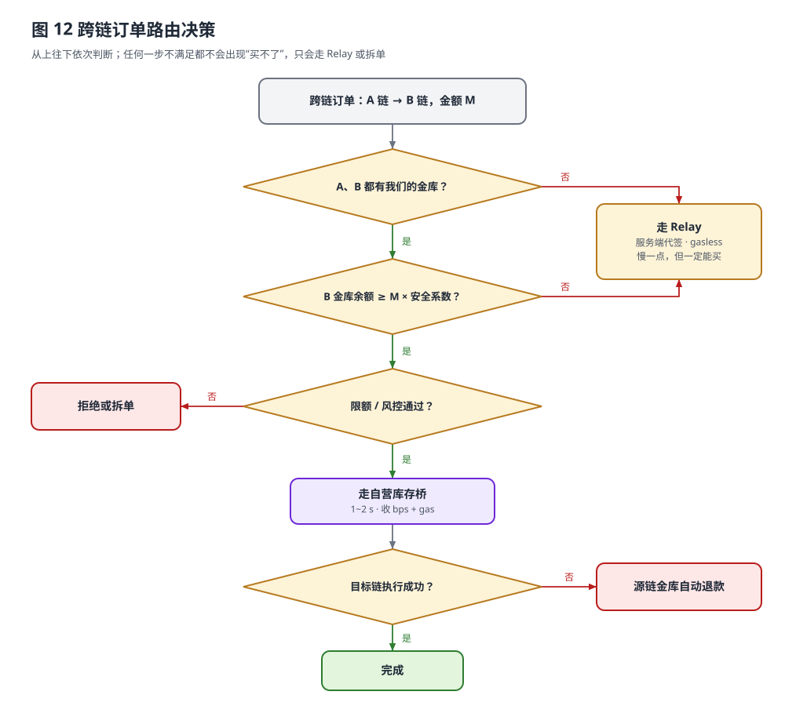

### 6.4 自研模块清单

| 模块 | 要做什么 | 关键点 |
|---|---|---|
| 托管密钥服务 | 每个第三方登录用户一套多链地址（Solana + EVM 同一个地址），私钥不能导出 | 选 MPC / TEE 服务商（Turnkey、Privy Server Wallet、Fireblocks 等），或者自建 KMS + Nitro Enclave；签名策略要白名单（只允许签金库、聚合器等合约） |
| EVM 账户代付 | 用户地址通过 **EIP-7702** 委托给我们的批量执行合约，执行器代付 gas | 链上已验证 BSC 支持 type 4 交易；不支持 7702 的链可以退回 ERC-4337 Paymaster |
| Solana 账户代付 | 我们当 fee payer，用户托管密钥做第二签名 | 和 Pump 的 `FHpc…` 一样 |
| 金库合约（每条链） | 存 USDC 库存；`deposit` / `buy` / `sell` / `payout` / `refund`；orderId 事件 | 只允许执行器调用；单笔限额；暂停开关；提款需要多签 + 时间锁；聚合器白名单 |
| Solana 金库程序 | 和 Pump 的 `Dsug6J` 一样：入金、出金、平台费分账 | 出金权限和 fee payer 用不同的密钥（Pump 也是这样分开的） |
| 原生币入金 / 出金 | 用户用 SOL、BNB、ETH 付款时，在**同一笔交易**里先通过 Jupiter 或 0x 换成 USDC，再存进金库；出金时反过来 | Pump 目前只做了"出金换 SOL"，用 SOL 买还要回退到 Relay（§3.7）。我们第一版就把入金这一步做好，主流币买入就不用依赖 Relay |
| 报价 / 路由 | 接 0x、1inch、OKX、Jupiter 等；动态滑点；自营或 Relay 路由 | meme 要处理 fee-on-transfer 和貔貅盘检测 |
| 订单 / 对账 | orderId 贯穿两条链；状态机；幂等 | 日终对账：各链金库余额 = 账本余额 |
| 执行器 | 每条链一个热钱包代付 gas；nonce 管理；失败重试 | 热钱包里只放少量 gas，自动补充 |
| 再平衡 | 按水位线调拨；能用双向流量对冲就先对冲 | CCTP 优先（USDC 原生跨链、便宜）；紧急时用 CEX |
| 充值 / 提现 | 长尾链充值、跨链提现走 Relay，或者先换成 USDC 再走 CCTP | 不追求秒级，降低库存需求 |
| 风控 / 监控 | 限额、异常告警、金库水位、失败率、耗时大盘 | 托管资金 → 需要审计、保险、出入金报警 |
| 收费 | 平台费 bps + gas 实报实销（参考 Pump 卖出的做法） | 小额订单要设置最低费用或最低下单金额 |

### 6.5 分阶段落地

| 阶段 | 做什么 | 目的 |
|---|---|---|
| 1 · MVP | 托管钱包 + 7702 代付；跨链全部走 Relay（服务端代签）；插件钱包本链交易；多链充值 | 不准备库存，几周上线，先验证需求 |
| 2 · 看数据 | 统计各线路的交易量、净流量、失败率、耗时 | 找出值得自营的头部线路 |
| 3 · 热门线路自营 | 在 2~3 条热门链部署金库（如 Solana / BSC / Base），自营库存桥上线，Relay 兜底 | 在头部线路拿到 Pump 同级的速度和收入 |
| 4 · 扩展 | 更多链的金库、再平衡自动化、按数据调整费率 | 规模化 |

- **如果启动资金充足、团队有合约和运维能力**：可以跳过阶段 1，直接从阶段 3 开始（Pump 和 FOMO 都已经证明这条路走得通）。
- **如果想先验证需求**：阶段 1 只要接 Relay API，不需要准备库存，几周就能上线。托管钱包和 7702 代付这两块在后续阶段都能直接复用。


---

## 7. 名词解释（给非技术同学）

| 名词 | 通俗解释 |
|---|---|
| 跨链桥 | 把 A 链上的钱"变成" B 链上的钱。大多数情况下钱并不真的移动，而是 A 链收一笔，B 链付一笔 |
| Solver | 帮用户在目标链先垫钱办事的"跑腿商人"，事后再去源链把用户的钱取回来 |
| Depository | Relay 在每条链上的"保险箱"合约，用户的钱先锁在里面，Solver 证明自己办完了事才能取 |
| Oracle | "公证人"：看两条链上的记录，签字证明"用户存了钱、Solver 办完了事" |
| Relay Chain / Hub | Relay 专门用来记账的一条链，账本上记着谁欠谁多少钱 |
| MPC | 多方计算签名：私钥被拆成多份，由多个节点一起签名，任何一方都无法单独动钱 |
| 库存式桥（Pump Bridge） | 平台自己在每条链上都放好钱，用户在 A 链付钱，平台直接用 B 链上的钱交付，平台之间自己调账 |
| 再平衡 | 某条链上的库存不够了，就从钱多的链调一些过去 |
| EIP-7702 | 让普通钱包地址临时"变成"智能合约账户，可以批量操作，也可以由别人代付 gas |
| 内嵌钱包 | 用邮箱 / 社交账号登录就自动生成的钱包，私钥由服务商安全托管或分片保存 |
| bps | 基点，1 bps = 0.01% |

---

## 8. 已确认 / 待确认事项

**已确认**
- ✅ 卖出到账 0.899372 USDC；扣费 = 0.45% 平台费（0.004148）+ BSC gas 实报实销（0.018452），分毫不差。
- ✅ 买入时 Solana 只有一笔 1 USDC → 金库的转账，fee payer 是 Pump 的 `FHpc…`；卖出出金只需要 Pump 的 `6aQt…` 签名。
- ✅ 我们项目的范围：多链充值；插件钱包只做本链交易；跨链买币只给第三方登录钱包用（服务器托管私钥，不能导出）→ 见 §6.2 ~ §6.5。
- ✅ **用 SOL 买会走 Relay**（Relay Depository `99vQwt…`，Solver + KyberSwap 在 BSC 填单）；Relay 官方 API 给出了完整费用明细，Pump 的 App Fee 是 15 bps（§3.7.1）。
- ✅ **卖出想收 SOL**：Pump 金库照样出 USDC，在同一笔 Solana 交易里用 Jupiter 换成 SOL；扣费规则仍然是 0.45% + gas 实报实销（§3.7.2）。
- ✅ Pump 每条主力链大约放了 $77 万 USDC 库存（Solana 770,042 / BSC 765,502）。
- ✅ 用户 BSC 地址的 7702 委托是持续有效的，第二次卖出用的是普通 type 2 交易。

**待确认**
1. **买入的约 0.05 固定费**：目前按推测写（0.45% + 约 $0.05）。建议用 10 USDC 和 100 USDC 各测一次买入，对比实际进入 BSC swap 的 USDC，就能拆出"百分比 + 固定部分"。
2. **SOL 买入的路由规则**：是"只要用 SOL 就走 Relay"，还是按金额、链或者 A/B 分流？建议再用 SOL 买一次大一点的金额、买一次其他链（如 Base）的 meme 来验证。
3. **7702 委托合约**：`0x0000…9b8f00` 是否就是 Uniswap Calibur？
4. **启动资金和团队**：决定 §6.5 从阶段 1（先接 Relay）开始，还是直接上自营库存桥。参考 Pump 每条链约 $77 万库存（他们交易量很大，我们起步可以少放很多）。

---

## 参考资料

- Relay — How it works: https://docs.relay.link/references/protocol/how-it-works
- Relay — How Relay works: https://docs.relay.link/how-relay-works
- Relay — Relay Chain: https://docs.relay.link/references/protocol/components/relay-chain
- Relay — App Fees: https://docs.relay.link/features/app-fees
- Relay — Fees: https://docs.relay.link/references/api/api_core_concepts/fees
- Relay 订单查询（第二次买入）：https://api.relay.link/requests/v2?hash=f5Lb9RSfy9odsRidGcDozsHi9cRm88gTMBuUkxyguh76uSJv4UuNtYpGxKvfs7DP8xcui8VAYhx86hGtNR9BJkN
- Pump.fun 公告: https://x.com/Pumpfun/status/2112980077881266326
- Bankless: https://www.bankless.com/read/news/pump-fun-ditches-relay-for-in-house-pump-bridge
- Crypto Briefing: https://cryptobriefing.com/pumpfun-pump-bridge-replaces-relay/
- KuCoin News: https://www.kucoin.com/news/flash/pump-fun-launches-pump-bridge-to-replace-relay-claims-92-fewer-errors
- 测试交易：
  - 买入 Solana：https://solscan.io/tx/4nCsVRuBWHEET62gtqukvXc2y7y1HLJ5CmSPzgmo6m1HyedZWgaD3qXy1ftuunyULaf9fHscMKJPPDwiW6oE4y79
  - 买入 BSC：https://bscscan.com/tx/0xe248490fe0dd8e3c2155d1c4d1cf7bdfba686f004bc7ddf35bde13446b49dae3
  - 卖出 BSC：https://bscscan.com/tx/0x485285bd960f0e3d0b1e4718d2da0708fbe9be93bafa9624136cc4a562583f3c
  - 卖出 Solana：https://solscan.io/tx/5ZG7XhvwG9796WSHoJig8KQ989r7g3TKF16YqqUEBDX7kNKQcAtyevDAq7Tgh7iPCiD4rYBwrMmPdrGJyfVM7jub
- 第二次测试交易：
  - 买入 Solana（Relay 存款）：https://solscan.io/tx/f5Lb9RSfy9odsRidGcDozsHi9cRm88gTMBuUkxyguh76uSJv4UuNtYpGxKvfs7DP8xcui8VAYhx86hGtNR9BJkN
  - 买入 BSC（Relay Solver 填单）：https://bscscan.com/tx/0xba2195067b31f851b070e45b9bba7448c965db0013596851d192d983cbc67eb3
  - 卖出 BSC（Pump Bridge）：https://bscscan.com/tx/0x72567b0d6abd542bbd0d02a91f79111d3fa5cbb1ed944f198d0134096d29c833
  - 卖出 Solana（Pump Bridge + Jupiter 换 SOL）：https://solscan.io/tx/A3VmTSR27eedzFJaxQsDXbqY2wRBba1gaQMFT1fuiuyZUCCTSWTZzSVscwDXu2qi7mpq49ZAz72Doj4w7oiGarc
